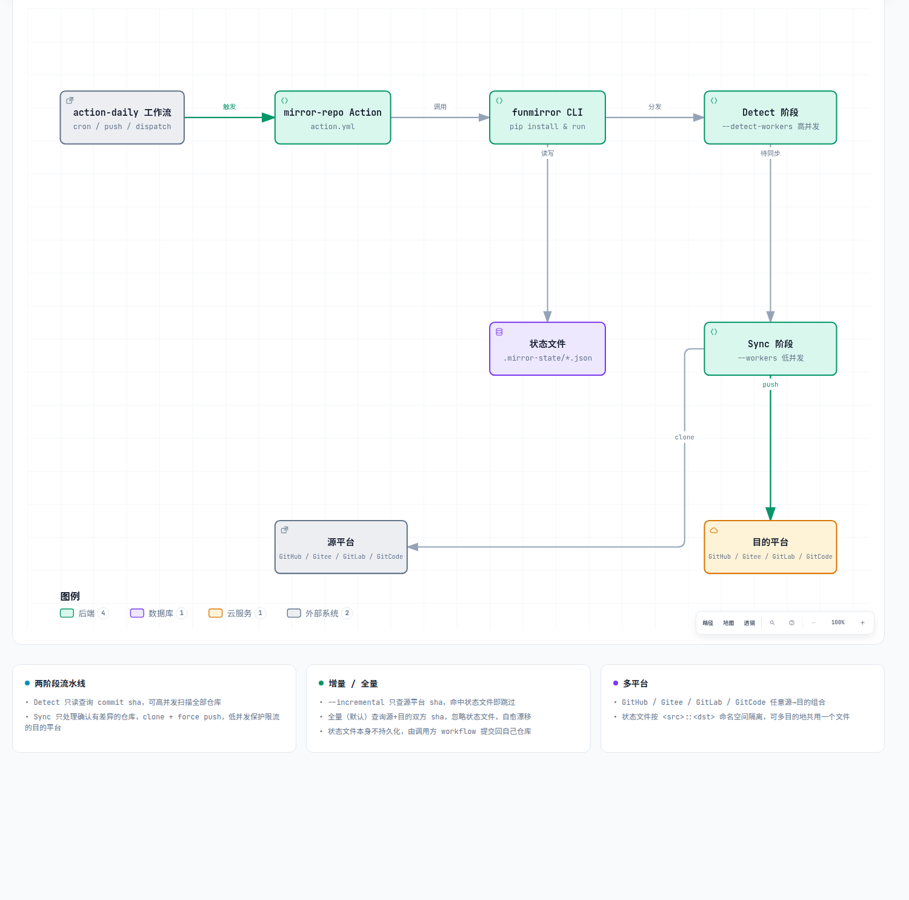

# funmirror

Mirror every repo from one hosting platform's organization to another's, in
parallel, skipping repos whose default branch hasn't changed since the last
run. Supports GitHub, Gitee, GitLab and GitCode as either source or
destination.

Built for [`farfarfun-action/mirror-repo`](https://github.com/farfarfun-action/mirror-repo),
which is a thin wrapper around this package's CLI. It reproduces the core
behavior of [`Yikun/hub-mirror-action`](https://github.com/Yikun/hub-mirror-action)
(clone from the source platform, force-push `refs/remotes/origin/*:refs/heads/*`
plus tags to the destination) without depending on that action, and adds three
things it doesn't have:

- **Two-phase parallelism** — a cheap, read-only *detect* phase (via a
  [`funworker`](https://github.com/farfarfun/funworker) pipeline,
  `--detect-workers`, default `max(workers*4, 16)`) checks every repo's
  commit id concurrently at high fan-out; only repos that actually differ
  move on to the heavier *sync* phase (`--workers`, default 8), which can be
  kept much lower to avoid overwhelming a rate-limited destination.
- **Skip-if-unchanged** — before cloning anything, the latest commit sha of
  the source and destination default branch is compared; if they already
  match, the repo is skipped entirely.
- **Release mirroring** (`--sync-releases`) — releases *and their attached
  files*, not just git refs. Off by default; see below.

## Architecture



`action-daily` triggers `mirror-repo`, which installs and calls this CLI.
The CLI dispatches a high-concurrency detect phase, then a low-concurrency
sync phase against the source/destination platform; the state file is read
and rewritten locally on every run, and persisting it across CI runs is the
caller's job (see "Incremental sync via a state file" below).

## Install

```bash
pip install "git+https://github.com/farfarfun/funmirror.git@v0.5.0"
```

## Usage

```bash
funmirror mirror \
  --src-platform github --dst-platform gitee \
  --src-org my-org --dst-org my-org \
  --dst-token "$GITEE_TOKEN" \
  --dst-key-file ~/.ssh/gitee_deploy_key \
  --src-token "$GITHUB_TOKEN" \
  --repo-names repo-a,repo-b \
  --workers 8
```

`--src-platform`/`--dst-platform` are one of `github`, `gitee`, `gitlab`,
`gitcode`. `--src-key-file`/`--dst-key-file` (SSH key for push) are only
required when the corresponding platform is `gitee`. `--src-endpoint`/
`--dst-endpoint` are only used for self-hosted GitLab instances.
`--repo-names` is optional; if omitted, every repo in `--src-org` is
mirrored (requires `--src-token` to list them).
Run `funmirror --help` or `funmirror mirror --help` for the complete command
reference.

Exit code is `1` if any repo failed to mirror; a one-line summary
(`Mirrored X, skipped Y, failed Z (total N)`) is printed and, if
`GITHUB_STEP_SUMMARY` is set, appended to it.

## How a single repo is mirrored

Mirroring happens in two phases, run as two separate concurrent pipelines:

1. **Detect** (`--detect-workers`, high concurrency): for every repo, look up
   the latest commit sha of the source default branch (in `--incremental`
   mode) or of both the source and destination branch (in full-sync mode,
   see below). Decide whether the repo needs syncing.
2. **Sync** (`--workers`, low concurrency): only for repos the detect phase
   flagged as differing — create the destination repo if it doesn't exist
   yet, then `git clone` from the source and `git push` (force by default)
   `refs/remotes/origin/*:refs/heads/*` plus tags to the destination, with
   retries.

Keeping these as separate worker pools lets detection run fast and wide
(it's just read-only API calls) while the actual clone+push traffic against
a rate-limited/WAF'd destination like Gitee stays throttled.

## Incremental sync via a state file

`--state-file PATH` persists a JSON map across runs, namespaced by
`<src-platform>/<src-org>::<dst-platform>/<dst-org>` so multiple platform
pairs can safely share one file without their progress getting mixed up:

```json
{
  "github/my-org::gitee/my-org": {
    "repo-a": {"src_sha": "abc123", "dst_sha": "abc123"}
  }
}
```

`--incremental` and full sync (the default, no `--incremental`) query
different things during detection:

- **`--incremental`**: only the *source* platform's commit sha is queried,
  for every repo. If it matches the state file's `src_sha`, the repo is
  skipped **without ever querying the destination platform**. If it doesn't
  match (or there's no state entry yet), the repo goes straight to the sync
  phase — trusting that the destination was already in sync as of the last
  recorded `src_sha`, so there's no need to read it first either.
- **Full sync** (no `--incremental`): both the source *and* destination
  platform's commit shas are queried for every repo, ignoring the state file
  for the skip/sync decision entirely — only repos whose source and
  destination shas actually differ are synced. This is what self-heals any
  drift an incremental run might have left behind (e.g. someone pushing
  directly to the destination).

```bash
# hourly, cheap: only the src platform is queried; most repos short-circuit
# off local state without a single dst API call
funmirror mirror --src-platform github --dst-platform gitee \
  --src-org my-org --dst-org my-org --dst-token "$GITEE_TOKEN" \
  --dst-key-file ~/.ssh/gitee_deploy_key --state-file .mirror-state/gitee.json \
  --incremental

# daily, thorough: queries both src and dst for every repo and ignores the
# state file for the decision, then rewrites the state file from the
# confirmed results
funmirror mirror --src-platform github --dst-platform gitee \
  --src-org my-org --dst-org my-org --dst-token "$GITEE_TOKEN" \
  --dst-key-file ~/.ssh/gitee_deploy_key --state-file .mirror-state/gitee.json \
  --workers 2
```

A repo's state entry is only ever updated once its shas are *confirmed*
(either via a detect-phase match, or after a successful push) — a repo that
fails to sync leaves its previous state entry untouched, so it's retried for
real on the next run instead of being incorrectly marked up to date.
`funmirror` only reads/writes the file locally; persisting it across CI runs
(e.g. committing it back to a repo) is the caller's responsibility.

## Mirroring releases

A git mirror copies refs. It does not copy releases, and it certainly
doesn't copy the binaries attached to them — which for a tool distributed as
a prebuilt binary is the only part users actually need. `--sync-releases`
adds a second pass, run strictly *after* the push (a release points at a
tag; creating one for a tag the destination has never heard of either fails
or invents one off the wrong commit):

```bash
funmirror mirror --src-platform github --dst-platform gitee \
  --src-org my-org --dst-org my-org \
  --src-token "$GITHUB_TOKEN" --dst-token "$GITEE_TOKEN" \
  --dst-key-file ~/.ssh/gitee_deploy_key \
  --repo-names my-tool \
  --sync-releases --release-limit 5
```

Currently GitHub can be a release source and Gitee a release destination.
Other combinations are rejected up front with one line, rather than failing
identically once per repo.

What the pass does, per release, oldest first:

1. Look the release up on the destination by tag; create it if missing.
   Drafts on the source are skipped — a draft isn't public there, so
   mirroring it would leak it.
2. Diff the attachments by name. Upload the missing ones; re-upload one
   whose size disagrees (deleting the stale copy first — Gitee has no
   overwrite, you'd end up with two files of the same name). Leave the rest
   alone.
3. Download and upload one asset at a time, deleting the local copy
   immediately, so peak disk is one asset rather than one release.

Two costs worth knowing before turning this on:

- **Every selected repo gets a release listing on both sides, every run,
  even the unchanged ones.** Publishing a release moves a tag, not the
  default branch — so a repo whose branch sha is identical can still be
  missing its newest release. Skipping those on the sha alone would make
  release mirroring miss exactly the case it exists for. `--sync-releases`
  therefore routes up-to-date repos into the sync phase too, where the
  clone+push is skipped and only the release diff runs.
- **`--release-limit N` caps it to the N most recent releases per repo.**
  Default `0` is all of them; on a repo with a long history and large
  binaries, the first run moves all of it.

Needs `--dst-token` (the SSH key only covers git, not the REST API) and a
`--src-token` for private sources. A repo with releases disabled reads as
"no releases" rather than an error. A release failure fails that repo and
leaves its state entry untouched, so the next run retries it.

## Development

```bash
pip install -e ".[dev]"
pytest
```
